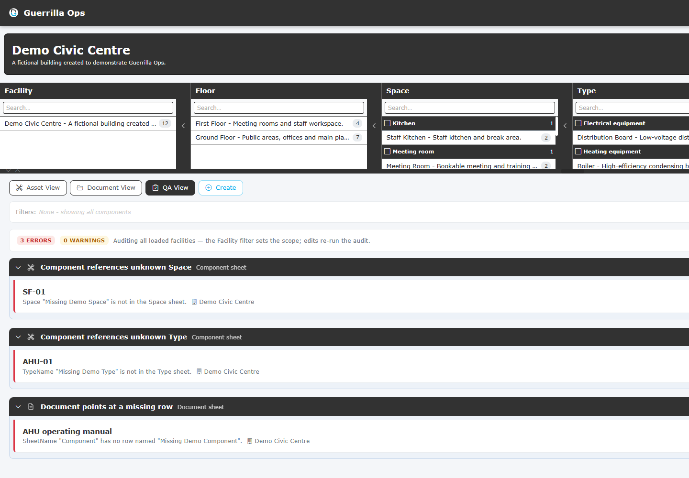
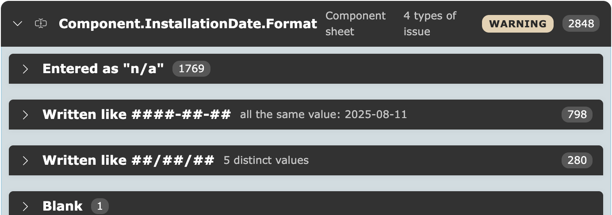

# QA View

[Guide index](README.md) | Previous: [Document View](04-document-view.md) | Next: [Edit and create records](06-edit-create.md)

QA View audits loaded COBie data for common completeness and relationship problems.

## Start an audit

> [!NOTE]
> The screenshot may use deliberate in-memory broken references to demonstrate QA findings. A clean workbook can show no findings.

1. Select **QA View**.
2. Optionally select one or more Facilities to limit the audit.
3. Review the summary counts and grouped findings.
4. Expand a group to inspect individual records.

If no Facility is selected, every loaded Facility is audited.

## See why a check failed

Opening a check shows the causes inside it before the individual records, each with
its count. A cause says why the check failed, for example a value entered as `n/a`,
or a date in the wrong format. Where a cause has an invalid format, the records are
grouped one level further by how the value was written, such as `##/##/##`.

Where several records share a cause or a written pattern, it shows how many distinct
values they hold, and names the value when they all match, so you can see at a glance
that nothing else is hiding there. If everything in a check has the same cause, a
single line says so and the records follow directly.

A cause only explains a finding. Each finding has one cause and keeps its check's
severity, and no cause adds a check or changes a count or score. The downloaded
report carries the cause in its **Cause** column.

The causes and their wording are defined in the XML profile, so a profile can reword
them. **A profile must define the shared `<causes>` block** (a top-level `<causes>`
element holding `blank`, `not-applicable`, `invalid-format`, `not-a-number`,
`negative-number`, `repeated-key`, `no-rows`, `wrong-row-count`, `no-match` and
`other`), and its `Reference` rule must define `not-found` and `prefix-match`. If a
customised profile lacks any of them, QA does not fall back to built-in wording: the
audit applies no rules and shows a profile error naming what is missing. Copy the
`<causes>` block from the bundled profile into yours.

A rule or format can add its own causes, or reword a shared one for its own findings,
such as the `Reference` rule or a date format. A reference can also switch on an extra
diagnostic with `causeDiagnostics`, for example `causeDiagnostics="colon-prefix"` on a picklist
such as `Pr_20_31: Name`. A value whose text before the colon matches a listed value
but whose wording differs is still an unresolved reference. The diagnostic says only
that the prefix matches. A profile with an unknown `causeDiagnostics` value, or a
missing or duplicated cause, stops the audit with an error that names the problem.

## Understand severity

| Severity | Meaning | Suggested response |
| --- | --- | --- |
| **Error** | A key record or required relationship cannot be resolved | Investigate first |
| **Warning** | Data is missing or likely to reduce usefulness | Review and correct where appropriate |
| **Info** | A condition is worth noting but may be intentional | Confirm against project requirements |

Severity indicates data quality risk, not necessarily workbook corruption.

## Checks you may see

QA View checks areas such as:

- Blank key names.
- Components referring to missing Types or Spaces.
- Spaces referring to missing Floors.
- Systems referring to missing Components.
- Documents referring to missing rows or unsupported sheets.
- `CreatedBy` values that do not resolve to Contact data.
- Missing or unusual Facility rows.
- Incomplete values on important records.

The exact findings depend on the sheets and relationships in the loaded workbooks.

## Fix a finding

Where a finding maps to an editable record, select its pencil action. QA uses
the correction form rather than the inline Information view so the related
changes can be reviewed together before they are applied.

1. Read the finding message carefully.
2. Open the affected record.
3. Correct the property or association.
4. Select **Save Changes**.
5. Return to QA View. The dashboard rebuilds from the modified in-memory data.

Some findings describe a missing record. Use **Create** to add the missing Type, Space, Component, System, or Contact, then review the audit again.

## Download the QA report

Select **Download Report** to export the findings for review outside the application.

Use the report when:

- Assigning issues to information owners.
- Keeping evidence of a review.
- Working through a result group that is capped in the on-screen view.
- Comparing QA results before and after corrections.

The QA report is separate from saving workbook changes.

## Avoid misleading results

- Select the correct Facility when similarly named records exist in different workbooks.
- Clear global search if you need a complete audit view.
- Treat project-specific optional fields according to the project's information requirements.
- Save or download corrected workbooks before refreshing the browser.

## Next step

See [Edit and create records](06-edit-create.md) for detailed correction workflows.
